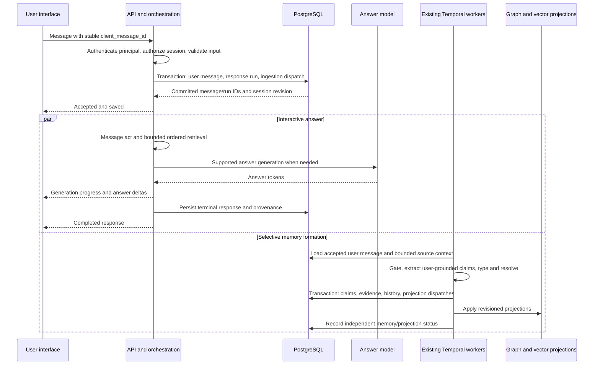

# Engram production delivery plan — ordered retrieval and trustworthy conversation memory

Revised: 2026-09-29. Status: **implementation in progress; verified delivery and remaining release gates are recorded in [IMPLEMENTATION_STATUS.md](IMPLEMENTATION_STATUS.md)**.

This is the delivery plan for the complete product, preserving the agreed ordered retrieval architecture. It incorporates the user's production-product requirements, the recent implementation review, and the [repository/product audit](PRODUCTION_PRODUCT_AUDIT.md). It supersedes conflicting priorities and current-state claims in `ENGRAM_BEST_SYSTEM_PLAN.md`; that document remains useful historical design context.

The user has now authorized implementation. This release is **tenant/API-key scoped**. Private-user login and shared-project authorization are explicitly deferred. Runtime changes and isolated database migration tests are described in the implementation record; no development/production migration or deployment has been performed. The remaining specifications below continue to define work and release gates, rather than claiming completion.

**Product promise:** users can talk naturally, return to their conversations, rely on selected memories with visible sources, correct or forget information, and share only what they explicitly authorize. PostgreSQL remains authoritative; Redis, vectors, Neo4j and summaries accelerate discovery or presentation.

**First delivery priority:** ownership and trust → durable messages and reliable chat → safe automatic user-memory formation → evidence-complete retrieval and source-linked consolidation → complete memory controls → operational proof. Retrieval and consolidation are core engineering workstreams. Their correctness precedes optional ranking and visual refinements.

Read the [inventory and findings](PRODUCTION_PRODUCT_AUDIT.md#3-component-inventory), then [message lifecycle](#proposed-message-and-memory-lifecycle), [delivery milestones](#delivery-milestones-and-dependencies), and [acceptance scenarios](#acceptance-scenarios-and-test-strategy).

For implementation depth, use the [retrieval and consolidation engineering design](RETRIEVAL_CONSOLIDATION_DESIGN.md). It adds eight focused findings, seven implementation packages and twenty-six acceptance cases, including a reproduced canonical overview prompt failure. It defines complete-answer coverage, temporal semantics, evidence bundles, source lineage, atomic summary publication, Temporal coalescing and required BM25/vector hybrid retrieval. The implementation record identifies completed changes and unresolved contracts.

**BM25 revision:** the user's request makes BM25 candidate search plus vector search and reciprocal rank fusion an explicit M3 deliverable. Its position, backend, source contracts and release tests are specified below. The existing PostgreSQL full-text search and unused Neo4j full-text index declaration do not count as completed BM25 integration.

**Sufficiency architecture revision (2026-09-29):** use the [focused sufficiency architecture plan](SUFFICIENCY_ARCHITECTURE_PLAN.md) for the next R1/R2 and RC-A/B implementation. It records reproduced gaps and defines one server-owned controller, per-question requirements, typed conversation/canonical evidence, deterministic eligibility checks, and a separate structured semantic evaluator. This is a proposed refinement; it has not replaced the current runtime gate. A separately trained classifier or new service is not required for its first delivery.

## Decisions preserved

- PostgreSQL is canonical for memories, evidence, history, accepted messages and workflow handoff. A verified claim represents supported system knowledge within its source, scope and validity; storage alone does not prove objective real-world truth.
- This release uses tenant/API-key authorization, as explicitly selected by the user. Private-user identities and shared-project grants remain a future product expansion and are not implemented or required for this release. A tenant API key grants tenant-wide access; do not present it as private per-user access.
- Automatic memory is selective and grounded in user assertions or explicit confirmations. Assistant-generated assertions are not independent evidence.
- Raw conversation retention is 90 days. Selected durable facts and minimal supporting evidence persist until deletion or an applicable expiry policy; the UI must explain this distinction.
- Temporal and the existing transactional outbox own durable background ingestion, projection and consolidation. Keep existing infrastructure; do not introduce a second queue or vector database without measured need.
- Neo4j uses controlled/versioned schemas and parameterized, bounded read templates. Generated Cypher and autonomous schema mutation are not release prerequisites.
- The target is high availability; Compose is a single-host operating option, not proof of that target.
- The existing admin console remains a privileged operator tool. A personal-user experience must use actual principal authorization, not the shared admin cookie.

## Required retrieval order

For questions, preserve this server-owned progression:

```text
L0: parametric knowledge
  → L1: current session (cache, with PostgreSQL fallback)
  → sufficiency decision (shared controller and selective semantic evaluation)
  → L2: relevant past sessions in PostgreSQL
  → L3_FACTS: canonical PostgreSQL facts and temporal history
  → L3_VECTOR: BM25 + vector discovery, PostgreSQL verification, RRF
  → L3_GRAPH: bounded Neo4j traversal, then PostgreSQL verification
  → answer, qualified partial answer, or explicit insufficient evidence
```

Each stage stops only when it can support the complete question. The server
enforces the order; a model can refine search arguments, not bypass stages.
L0 handles self-contained, stable general questions. Personal facts, private
entities, conversational references and time-sensitive questions continue to
memory. Model confidence alone is not evidence for a private fact.

Reconcile this order with the attachment's adaptive-routing examples as follows: consider stages in order, perform only eligible/useful work, and stop when sufficient. Empty or inapplicable stages can be explicitly skipped without database/model calls. Exact facts and history use PostgreSQL within the facts capability; hybrid ranking belongs within semantic discovery; graph work is bounded and relevant. The planner cannot jump arbitrarily between stores. Trace **considered, skipped, attempted and sufficient** separately so a stage label does not imply a tool call.

Statements and corrections additionally take a conversation-action path; forcing every user utterance to be a retrieval question is not part of the agreed order.

## Implemented retrieval baseline

1. Keep existing canonical adapters and exact-fact rendering. Separate the new
   public stage names from the legacy L1–L4 repository capability names. Emit
   stage, source, sufficiency and latency metadata. Interpret request `L0`,
   `L1`, `L2`, `L3` as cascade depth; accept `L4` as the full-cascade legacy alias
   and `SESSION` as L1. Respect depth limits before any deeper tool call.
2. Persist session snapshots and lifecycle in tenant-scoped PostgreSQL
   `session_states`; atomically append turns and source events under a session
   lock, then publish the cache. After cache expiry recover snapshots, falling
   back to conversation events for pre-migration sessions. Preserve turn indices,
   closed status and derived-answer flags. Search older original turns when the
   cached tail is insufficient. Include
   caller-supplied chat history as session context, labelled as conversation,
   never as canonical claims. Keep role boundaries and token budgets.
3. Add bounded PostgreSQL full-text search of previous sessions, excluding the
   active session. Use existing session summaries as optional discovery hints
   and load the linked original conversation records. Do not infer that an old
   assertion is still current. Return source event/session identifiers; past
   assistant answers are conversation history, not independent factual evidence.
4. Expose controlled semantic tool contracts: `current_session_search`,
   `past_session_search`, `facts_search`, `semantic_memory_search`, `graph_search`.
   Authorization scope is server-owned. SQL/Cypher is never a model argument.
   Reuse the existing model planner for search hints after L1; the existing
   ANSWER/NEED_MORE protocol supplies the current tentative sufficiency gate.
   Its planned replacement is the shared controller specified in
   [SUFFICIENCY_ARCHITECTURE_PLAN.md](SUFFICIENCY_ARCHITECTURE_PLAN.md), while
   preserving server-owned retrieval order and canonical eligibility checks.
5. Search facts using the existing `memory_claims` and temporal repository reads.
   Vector candidates retain stable IDs and must pass PostgreSQL hydration.
   Graph search uses whitelisted parameterized templates, bounded hops/rows/time,
   checks every traversed tenant, and rejects paths with missing canonical edges.
   The physical graph schema and predicate registry remain controlled/versioned;
   consolidation cannot execute arbitrary schema changes.
6. Add session snapshots and PostgreSQL indexes for session reads and original-record text search in
   an Alembic migration and fresh-database schema. Do not run migrations against
   the user's development/production database during implementation.

## Retrieval baseline validation and rollout

- Prove early exit at L0, L1, L2 and each knowledge-base stage; record exact
  call order, and verify no deeper calls occur after sufficient evidence.
- Test cache miss/recovery, PostgreSQL outage, cross-tenant filtering, exclusion
  of the current session, old facts versus current questions, malformed planner
  output, model NEED_MORE/failure, bounded context, and request depth limits.
- Test vector hydration and stale/deleted candidates; test parameterized graph
  execution, missing edges, tenant checks and timeout/degradation.
- Run existing retrieval, session, provider, API and Temporal projection tests
  using isolated test storage. Report unavailable infrastructure explicitly.
- Deploy schema indexes before application rollout; compare stage latency,
  escalation, unsupported answers and retrieval accuracy before broad rollout.

Migration prerequisite: apply Alembic `0005_ordered_retrieval` before starting
the updated API. New stage names are returned in both SDKs. Existing `sources`
continues to mean verified canonical memory; conversational references are in
`retrieval_metadata.source_records`. `max_reentries` remains accepted for client
compatibility; bounded forward escalation is controlled by the cascade itself.

## Required BM25 and vector hybrid retrieval

Implement **BM25 lexical search + vector search + reciprocal rank fusion (RRF)** inside the existing `semantic_memory_search` capability after the PostgreSQL facts stage. Preserve the public `L3_VECTOR` stage label for compatibility; additive metadata identifies the channels and fusion method. Graph relationship traversal remains the later stage. A sufficient L0/L1/L2/facts answer must trigger no BM25/vector calls.

| Concern | Delivery decision |
|---|---|
| BM25 backend | Use the existing Neo4j full-text/Lucene capability with a controlled `db.index.fulltext.queryNodes` adapter. Version-specific source review supports BM25 for the repository's Neo4j 5.24/Lucene 9.11.1 stack; real-engine compatibility tests are mandatory |
| PostgreSQL authority | Hydrate and authorize stable candidate IDs in PostgreSQL before answer context. BM25 scores identify candidates; they do not prove claim validity |
| Indexed content | Versioned deterministic text for current canonical memory IDs: names/aliases, supported typed claims and bounded source context. Preserve source/revision metadata; do not index assistant-generated assertions as facts |
| L2 past sessions | Keep PostgreSQL original-record FTS, labelled accurately as `ts_rank_cd`. This BM25 deliverable initially applies to knowledge discovery; it does not silently move L2 history into Neo4j |
| Scope | Mandatory server-owned scope clauses inside lexical candidate generation before top-K; no raw model/user Lucene syntax. Repeat canonical access/deletion checks before loading evidence |
| Fusion | Bounded BM25/vector calls may run concurrently inside this stage; deduplicate/hydrate eligible IDs, then combine 1-based ranks with RRF. Do not add incomparable raw BM25 and cosine scores |
| Stable unit | Both channels initially rank canonical memory IDs. Claim-level representations require an explicit mapping/version migration; duplicates cannot multiply votes |
| Consolidation and updates | Existing Temporal/outbox projection work updates lexical content after claim corrections, evidence changes, unmerge, deletion and scope changes. Summary generation is not required before indexing a committed fact |
| Failure/rollback | Surviving channel can continue; Neo4j outage may remove both channels. Keep session/exact/history and explicitly labelled PostgreSQL FTS fallback where useful. Retain prior retrieval/index configuration for rollback |
| Acceptance | Real-engine BM25 tests, deterministic RRF, query-scope enforcement, stale/deleted evidence rejection, bounded latency, restart/rebuild and held-out quality comparison; RC-T19–RC-T26 |

The first backend needs no additional search service or PostgreSQL extension. Neo4j's full-text index must be explicitly queried and `ONLINE` before use; index creation alone is insufficient ([Neo4j full-text documentation](https://neo4j.com/docs/cypher-manual/5/indexes/semantic-indexes/full-text-indexes/)). The [focused BM25 design](RETRIEVAL_CONSOLIDATION_DESIGN.md#bm25-and-vector-hybrid-search--required-implementation) records the version-specific scoring evidence, query construction, index rollout and detailed algorithm.

Start evaluation with equal RRF weights and `k=60`, twenty candidates per channel, up to forty unique hydrated candidates and twelve final memory candidates before token packing. The implementation provides configurable channel limits, timeout and RRF constant. These defaults are starting settings, not measured optimums. Enforce one request deadline across channels and fallbacks. Record BM25-only, vector-only, current baseline and hybrid results before canary enablement. Implementing BM25 is required; unsupported claims of improved accuracy are not part of acceptance.

## Retrieval experiments and limits

Keep the current vector projection as the baseline. Compare embeddings of
atomic fact text, graph-derived textual neighborhoods and their combination on
the same labelled questions, model, context budget and authorization scope.
Select alternative representations using answer correctness, evidence recall, p95 latency and cost; do not
claim a winning representation without running that evaluation. Raw graph
structure is not represented by a single useful text embedding.

BM25 and RRF integration are required work above. Alternative representations, learned fusion weights, neural reranking and changing the L2 conversation index remain controlled experiments.

LLM-generated Cypher and automatic ontology evolution are separate future
experiments, not prerequisites for the required retrieval order. This change
does not certify the full service for production: HA, erasure and other operational workstreams retain their own gates. Principal/project ACLs are deferred by the current release decision.
Retention/erasure must cover the new `session_states` snapshots as well as
original conversation events and derived projections.

## Historical validation record — 2026-09-28

- 118 selected unit/integration tests passed, covering cascade ordering,
  source boundaries, cache recovery, atomic session writes, buffered/streamed
  chat, model-provider compatibility, and Temporal projection/workflow regressions.
- PostgreSQL 16 and Neo4j 5.24 were run in isolated test instances. Actual Cypher
  tests verified multi-hop paths, tenant checks, row/hop bounds and parameterized IDs.
- Migration from `0004_claim_identity_policy` to `0005_ordered_retrieval` succeeded;
  all three new search/history indexes were valid afterward.
- Ruff, Python compilation, TypeScript `tsc --noEmit`, and whitespace checks on
  the changed implementation paths passed.
- No development/production database was migrated and no deployment was made.
  Live-model answer quality and alternative embedding representations still
  require the labelled evaluation described above.

## Proposed message and memory lifecycle

The remaining sections describe the target behavior. Use [IMPLEMENTATION_STATUS.md](IMPLEMENTATION_STATUS.md) for the tested subset, feature flags and remaining work. References to principals and project sharing describe the deferred expansion; tenant/API-key scope applies to this release.

### One accepted user turn, independent response and memory outcomes



The API does not call Temporal synchronously before acknowledging a committed message. The existing dispatcher starts work from the committed outbox. If durable acceptance fails, the UI keeps the draft and clearly reports it was not saved. It must never show an accepted indicator before commit.

Every accepted user turn is eligible for a bounded memory evaluation. Cheap rules may skip acknowledgments with no information; do not discard all questions, since questions can contain facts. Gate/extract runs asynchronously. Do not reprocess the complete session on every turn. Session close, compaction and scheduled consolidation are additional lifecycle events, not prerequisites for remembering the latest user statement.

### Conversation actions

| Input kind | Interactive behavior | Background memory behavior |
|---|---|---|
| General stable question | Try eligible L0; avoid unnecessary private retrieval | Usually skip unless the message also contains a user assertion |
| Context/history question | Ordered retrieval with correct speaker and time interpretation | Do not memorize the generated answer as a fact |
| New statement | Acknowledge naturally without demanding pre-existing evidence | Extract supported, useful user information |
| Correction | Acknowledge the correction; current-session context immediately reflects it | Apply ordered, provenance-preserving correction |
| Confirmation | Resolve only the bounded preceding question/proposal | Cite the confirming user text and its explicit referent |
| Mixed fact and question | Use the supplied fact to answer, then retrieve only what is missing | Process the assertion separately from the question |
| Forget request | Resolve deletion scope and follow the explicit product deletion contract | Durable erasure work; do not turn the request into a new remembered fact |
| Ambiguous referent | Ask a focused clarification | Keep proposed claims out of canonical current answers until resolved |

Use deterministic decisions for unambiguous cases and existing model orchestration for ambiguous ones. A new trained classifier is not required. Budget any added model call and evaluate it against routing accuracy and latency.

### PostgreSQL contracts and concurrency

Use an expand/backfill/contract migration, with exact DDL reviewed in implementation. Reuse existing events, claims, evidence, mutations and dispatch tables. The required logical records are:

| Record | Required fields/invariants |
|---|---|
| Session metadata | Tenant, owner principal, optional explicitly shared project, ACTIVE/CLOSED state, next sequence, revision, timestamps. Extend/normalize `session_states`; retain bounded compatible snapshot data during migration |
| Conversation message | Stable ID, tenant/session FK, server-assigned sequence, role, content, acceptance time, deletion state, retention deadline. Unique session sequence; unique scoped client message ID for user messages |
| Response run | Stable run ID, input message ID, attempt number, accepted context revision, state, deadline, terminal reason, output message ID and authorized provenance. One active generation per session initially; deliberate regenerate creates a new run, not a duplicate user message |
| Memory processing result | Source message/event ID, gate outcome, extraction version, current status, error class, canonical revision and separate projection status. Reuse event/artifact storage where it satisfies these invariants |
| Ownership/grants | Principal membership and explicit project permissions. Enforce tenant-consistent FKs and server-derived scope across all records |

Required guarantees:

1. Acceptance, response-run creation and ingestion outbox insertion commit together. A repeated client ID with identical input returns the same acceptance; a repeated ID with different content is rejected as a conflict.
2. Persist the user message before any remote model call. Preserve it if generation fails, is cancelled, or the browser disappears. Accepted message processing may continue independently of answer cancellation.
3. Serialize sequence allocation and initial active generation per session using PostgreSQL. Return a structured busy/conflict response without discarding the client draft. Do not hold locks during model calls.
4. Compaction, closing, message append and cache publication use revisions. Derived updates cannot overwrite newer messages. Close ends writing, not reading or retention; in-flight response handling is explicit and tested.
5. Treat the message log as authoritative and session snapshots as bounded materializations. Paginate history with stable cursors. Caller-supplied history remains labelled context unless imported through a validated, deduplicated message operation.
6. Use the existing `INGEST` dispatch family with an explicit user-message payload/version, or an equivalent compatible event envelope; adapt consumers deliberately. Do not flip `ingestible=True` on existing chat pairs.
7. API compatibility covers existing buffered chat, SSE consumers, explicit ingestion and both SDKs. New IDs/status fields are additive. Document versioned stream changes and preserve legacy adapters for a defined migration window.

### Safe canonical memory formation

Continue the existing pipeline:

`Gate → Episode → Atomic claims → Typed values → Identity resolution → Predicate normalization → Temporal resolution → Local match → Action → Canonical transaction → Outbox → Projections → Consolidation`

- Each automatic fact must reference a user message and validated supporting span. Context may resolve pronouns, dates or explicit confirmations, but cannot supply unsupported assertions from assistant output.
- Resolve “I” against the authenticated principal. Do not merge all people represented by a generic `user` alias inside a tenant. Names alone do not authorize identity merging.
- Preserve `ADD`, `REINFORCE`, `SUPERSEDE`, `CONTRADICT`, and retry `NOOP` as explicit outcomes. Identical statements can add distinct evidence without multiplying current facts. Conflicts are not silently resolved by model confidence.
- Keep assertion time, source sequence and real-world validity separate. Relative dates use the recorded message time/timezone. Queries distinguish “what was true then?” from “what did we know then?”
- An older delayed event must never replace a newer correction solely because it commits later. Compare temporal order under a scoped subject/predicate transaction lock; ambiguous simultaneous updates become explicit conflicts. Multiple legitimate values must respect predicate cardinality.
- Preserve history and source linkage. Privacy erasure is the explicit exception to indefinite provenance retention and must remove sensitive content according to policy.
- Persist extraction artifacts and version the extraction policy. Retries reuse committed artifacts; re-extraction is an explicit new processing version with controlled mutation identity.
- The final canonical transaction commits facts, evidence, mutation completion and projection handoff together. Projectors apply stable IDs and revision checks; deleted sources and tombstones fence late work.
- Do not launch full-session extraction or full-graph consolidation every turn. Coalesce bounded derived-summary work and use the existing Temporal maintenance machinery.

## Retrieval quality and controlled tools

### Eligibility and trust

Retain the existing tool names: `current_session_search`, `past_session_search`, `facts_search`, `semantic_memory_search`, and `graph_search`. History/provenance can initially be typed modes of the facts tool; add separate names only if evaluations demonstrate clearer model selection.

Each contract needs validated input types, when-to-use/when-to-skip descriptions, bounded result and token budgets, source IDs, source kind, temporal scope, canonical/projection revision, truncation and degradation reasons. The server injects authorization, deadlines and request IDs. The model cannot provide scope overrides, raw queries or database credentials.

| Stage | Required refinement | Acceptance evidence |
|---|---|---|
| L0 | Recognize safe public/general questions, including public named entities; still reject private/current unsupported facts | Public/private ambiguity corpus; no memory calls after a sufficient L0 answer |
| L1 | Latest accepted user message + bounded prior conversation; reconstruct reliably after cache failure; preserve task constraints | Immediate recall, restart, long-history and correction scenarios |
| L2 | Historical language must mean historical; return originals with dates/speakers; summaries are discovery hints | Paraphrase and historical/current pairs, source-linked results, active-session exclusion |
| Facts/history | Scope, deletion, predicate cardinality, effective time and provenance checked in PostgreSQL | Exact fact, supersession, multi-value, as-of and known-at tests |
| Semantic | Required BM25 + vector candidates, scoped PostgreSQL hydration and deterministic RRF within the existing stage | Real BM25 execution, full-question evidence support, bounded deadlines, held-out comparison and small-tenant recall test |
| Graph | Use only for useful relationships or remaining evidence gaps; verify every path edge and scope | Real parameterized Cypher tests, stale edges, deleted endpoints and path-budget tests |

Maintain source differences in API and UX: general model knowledge, a quoted conversation statement, canonical supported memory, and an uncertain inference are different. Conversation records must not acquire canonical status merely by passing through the answer model.

The evidence gate assesses the complete question, with explicit missing requirements, conflicts and possible qualified answers. Stop escalating when remaining stages cannot fill the identified gap. Never substitute similarity score for evidential support.

BM25/RRF integration is a required deliverable whose tuning and enablement depend on measured correctness and quality. Neural reranking, alternative fact/graph-neighborhood embeddings and semantic conversation indexes remain controlled experiments. Record corpus/model/prompt/index versions, authorization scope, recall, supported-answer rate, tokens, cost and p95 latency. Add no new storage system without a measured failure the existing PostgreSQL/Neo4j stack cannot address cleanly.

Context construction keeps necessary relationship/path evidence together. Batch hydration by authorized stable IDs. When a complete bundle cannot fit, retrieve a smaller supported answer or disclose the limitation. Do not silently cut the middle of a required chain.

### Retrieval implementation priorities

Implement against the existing cascade and domain/tool interfaces. BM25/RRF delivery and optional ranking experiments depend on the evidence and authorization contracts.

| Priority | Concrete implementation | Completion evidence |
|---|---|---|
| R1 — Complete-question coverage | Represent bounded answer requirements and map supporting evidence to each; reassess after final context packing | A location claim cannot fully answer a question asking for both location and employer |
| R2 — Correct source and time meaning | Preserve original speaker/spans; separate valid-time from known-at; consult predicate cardinality; version legacy `AS_OF` behavior | Retrospective versus known-at answers differ correctly; legitimate multi-value claims are not false conflicts |
| R3 — Complete context | Carry graph paths, corrections and confirmations as evidence bundles; allocate against actual model limits and a shared deadline | No missing edge/provenance after truncation; bounded partial answers when complete support cannot fit |
| R4 — Authorized discovery | Batch PostgreSQL hydration; bounded original-record excerpts; measure small-tenant ANN starvation and language/paraphrase misses | Recall and isolation measured independently; stale projection text cannot become current support |
| R5 — BM25 and vector hybrid retrieval | Implement scoped BM25 adapter, revisioned lexical projection and RRF with the vector channel; separately evaluate alternative representations and optional reranking | Real-engine and fusion tests pass; held-out correctness/recall/latency report; no deeper calls after sufficient evidence |

The planner may propose search hints; it cannot select authorization scope or skip required stage consideration. Keep similarity, source confidence and support for the actual question separate. An empty result, unavailable search capability and insufficient evidence have distinct internal outcomes and truthful user-facing handling.

## Consolidation quality and durable execution

### Per-turn work and asynchronous derived views

Every accepted user message is eligible for bounded memory evaluation. Assistant messages remain conversation context, with explicit user confirmation required before they support a user fact. Fact formation commits canonical claims and evidence; session compaction creates a digest of a defined message range; consolidation builds derived views of affected canonical scopes. Do not conflate these operations or rerun full-session/full-graph consolidation on every turn.

The interactive answer uses current-session context immediately and canonical facts after commit, independently of summary or projection freshness. A summary can help locate and present evidence, but cannot become independent evidence or silently mutate canonical claims. Preserve `ADD`, `REINFORCE`, `SUPERSEDE`, `CONTRADICT` and retry `NOOP`, with source identity, cardinality and effective-time rules.

### Correctness work before relying on summaries

The deeper review reproduced a blocking prompt mismatch: canonical relationship dictionaries use `subject_id/predicate/object_entity_id/object_value`, while `overview.j2` expects `subject_uri/relation/object_uri`. Strict rendering fails on nonempty canonical relationships before a model call. Fix the typed prompt/handler contract and test literal/entity values; do not suppress strict validation.

The current parent revision check also does not prove that all contributing child claims remained unchanged, and `save_overview` does not atomically compare input versions when writing. Required publication protocol:

1. Capture a bounded consistent source snapshot, exact dependency revisions, scope membership and authorization-policy version; close the transaction before generation.
2. Generate source-linked structured output outside database locks. Validate referenced IDs, types, size and support; preserve conflicts and uncertainty.
3. In one publication transaction, compare dirty generation and dependency versions using the same locking protocol as source mutations. Publish an immutable view version and current pointer only if the input is still valid.
4. If a source changes or is deleted/revoked, discard stale output and request current work. Never relabel old summary text with a new revision. Readers fall back to authorized canonical evidence while views are stale.

Define source dependencies explicitly so corrections, new scope members, unmerge, retention and deletion invalidate affected views. A manifest hash cannot detect a new source absent from the manifest without a scope-generation change. Mixed-access summaries must not expose sources a viewer cannot read. Bound large scopes with versioned partitions and transitive source lineage.

### Temporal coalescing and recovery

Reuse `consolidation_tasks`, the transactional outbox and the existing Temporal consolidation workflow. Current active-job deduplication is not a guarantee that changes arriving during a running job get processed. Extend it with requested/processed generations, durable due times and an atomic trailing-run decision. Use the existing outbox due-time facility; the worker rechecks persisted scheduling state when dispatch races a new request.

Debounce affected scopes with a maximum wait so continuous edits do not starve regeneration. The current 30-second configuration is a starting candidate, not proof that debounce is implemented. Apply bounded input, per-tenant fairness, model concurrency and token budgets. Deletion/revocation excludes data immediately and fences in-flight publication regardless of debounce.

Separate transient retry, changed-input replan, invalid prompt/schema failure, cancelled/deleted scope and terminal failure. Retrying after a publish must reuse the committed version; it must not create another mutation or reinforcement. Report task success separately from dispatch completion and view freshness. Reconciliation repairs missed handoff/dirty work; it must not be the only detector of a child correction.

Detailed contracts, code paths, the worked relocation example and mandatory race tests are in [RETRIEVAL_CONSOLIDATION_DESIGN.md](RETRIEVAL_CONSOLIDATION_DESIGN.md). The [current consolidation flow](CONSOLIDATION_FLOW.md) documents implemented behavior and its limits separately.

## Product experience and frontend delivery

### Information architecture

The normal-user workspace centers on **Conversations**, **Memories**, explicitly shared **Projects**, and **Settings**. Keep graph exploration, ingestion queues, raw traces and database details in the existing privileged admin surface. Codebase ingestion remains available; do not remove existing capabilities to simplify the personal experience.

Reuse Jinja, Alpine, the existing CSS build and local assets initially. Split the large inline chat object into small modules for transport, conversation state, message rendering and source display. Extract shared fetch/error handling instead of adding a frontend framework or global state library without evidence. The TypeScript SDK is not evidence that the present browser app is TypeScript.

PostgreSQL owns messages/run state; the browser owns drafts, selection, scroll position and transient transport state. A transport reconnect must reconcile with server state, not create another user turn. Scope browser caches by authenticated principal and clear them on logout/account change.

### Chat contract

- Restore actual paginated history and lifecycle, not only session IDs. Present readable titles, dates and a clear new-conversation action. User rename is deterministic; automatic titles may be deferred or generated cheaply without adding critical-path calls.
- Use a labelled multiline textarea, Enter to send and Shift+Enter for a newline, respecting IME composition. Prevent accidental concurrent sends and preserve drafts on failures.
- Present distinct states: sending, saved, working, receiving, completed, stopped, interrupted and failed. Memory processing is a separate status; session existence never means memory is ready.
- Implement Stop, retry failed generation, deliberate regenerate, copy, source details, restored conversations and network recovery. Assistant UI error banners are not conversation messages supplied back to the model.
- Use a persistent SSE parser with a bounded buffer. Handle every chunk boundary, multiple data lines, CRLF, UTF-8 splits, heartbeats, terminal events and truncated streams. Close/release readers and abort controllers on completion and page teardown.
- Give each run stable IDs and a status endpoint. On reconnect, load the durable response state. Persist bounded partial-output checkpoints if resuming partial responses is supported; otherwise clearly mark interruption. Exact token replay is optional and must not require an unbounded event log.
- For true streaming, complete scope/evidence checks before final-answer tokens. Where a model sufficiency decision is necessary, request a small decision rather than generating the whole answer twice. Wire the selected provider's stream/cancellation capability and measure the extra gate cost. Retain buffered support for providers without streaming.
- Cancellation marks the run durably, stops scheduling retrieval and closes provider streams where supported. Enforce timeouts where upstream cancellation is limited; label a stopped answer accurately. It does not erase an already accepted user message or undo committed memory.
- Parse Markdown, then sanitize HTML; safely render code, tables and links. Avoid full-transcript rendering on every token. Batch updates, respect user scroll position, and preserve focus.
- Inline citations open authorized source details showing statement, speaker, date and current/history status. Partial evidence must not be displayed as verified complete support.
- Integrate existing upload jobs through authorized attachment/source references rather than copying file content into every message. Preserve JSONL/CSV/ZIP and code-project workflows. Show uploading, processing, ready and failed states independently; a submitted file is not necessarily searchable yet. Enforce principal/project ownership, supported types, byte/expanded-archive limits, safe paths and retry identity. Do not expose a decorative attachment control before its backend contract exists; arbitrary new connectors/file formats remain separately scoped.

### Memory controls and understandable language

Memory items show a plain-language statement, source, last changed time, scope and current/historical/conflicting state. Provide search, correction, source navigation, session-only versus durable distinction and forgetting. Use real server timestamps; unknown dates remain unknown. Do not expose `mem://` IDs, embeddings or Cypher as the primary personal-user interface.

The server returns independent statuses for message persistence, generation, memory evaluation, canonical commit and projection freshness. Translate these into simple feedback such as “Saved,” “Updating memory,” or “Memory update needs attention.” Never promise durable memory merely because an assistant acknowledgment says “I'll remember.”

Conversation deletion and memory deletion are separate user choices with explicit effects. “Close conversation” preserves its history; it must not be labelled Delete. A destructive confirmation names the scope and shared-project impact. Do not ask users to choose internal storage layers.

### Coherent design and accessibility

Infer and consolidate the existing visual language: Inter, restrained neutral backgrounds, one primary accent, semantic success/warning/error colors and consistent Lucide icons. Define shared typography, spacing, borders, radii, buttons, form fields, focus states and loading patterns. Use a readable message measure, stable composer position and compact navigation. Avoid ornamental gradients, nested cards and animation without interaction value.

Validate 360/390px mobile, 768px tablet, 1280/1440px desktop, 200% zoom, long words/code, mobile keyboard and reduced motion. Provide a mobile navigation drawer with focus management. Allow browser zoom; maintain keyboard-visible focus, accessible names, labelled controls and sensible landmarks. Announce completion/errors without reading every streamed token. Test screen-reader and keyboard flows manually alongside automated checks. Target [WCAG 2.2 AA](https://www.w3.org/TR/WCAG22/); a scanner pass alone is not conformance proof.

For each screen, cover first use, empty result, loading, refreshing, partial data, offline, auth expiry, permission denied, failure and recovery. A failed load must not look like an empty account.

## Security, privacy and database operations

### Identity and authorization

- Use a stable upstream principal identity where the surrounding product already provides one; integrate it rather than inventing another identity service. Server authentication supplies tenant/principal context. Browser input cannot assign ownership.
- Keep tenant API keys for machine clients with explicit scopes. Make registry suspension/revocation authoritative; service failure must fail closed rather than reconstruct an active default identity.
- Default sessions and personal memories to private ownership. Projects are shared only through explicit membership/roles. Apply revocation immediately at canonical verification, regardless of stale projections.
- Authorize before discovery where feasible and always before evidence/context assembly. Every graph node and edge in a path must be accessible, not merely its endpoints. Shared summaries may contain only sources accessible to the viewer.
- Protect history, citations, export, search counts, errors, cache keys and job-status endpoints with the same policy. Administrative access remains explicit and audited.
- Use stable signed HttpOnly, Secure cookies on HTTPS deployments; server logout and expiry must work on every replica. Remove persistent browser API secrets. Add an explicit origin/CSRF policy for cookie-authenticated mutations, login throttling and safe return URLs.
- Keep prompt instructions separate from retrieved untrusted content. Test malicious conversation text, uploaded documents and tool output against scope and tool constraints.

### Database integrity and migrations

Separate runtime, migrator, dispatcher and Temporal database credentials. Runtime roles cannot own protected tables, bypass RLS or create schema. Apply appropriate RLS to canonical and conversation data; privileged dispatch access is explicit and narrow. Use transaction-local scope settings and verify no scope remains on pooled connections. Test with actual runtime roles, not only owners/superusers. PostgreSQL's [RLS owner behavior](https://www.postgresql.org/docs/16/ddl-rowsecurity.html) makes this distinction necessary.

Replace unbounded thread-local connections with bounded pool checkout and a transaction-bound unit of work. Preserve nested transaction semantics used by canonical commits. Set statement/lock deadlines, measure wait time and avoid model/network calls while database locks are held.

Use scoped unique constraints/FKs for identifiers, sequences, idempotency and ownership. Add indexes from measured access paths: session history, authorized message search, current subject/predicate claims, provenance and pending work. Verify plans and index validity; do not declare a new index useful without representative queries.

Freeze migration behavior: historical migrations must not silently change because they import evolving runtime schema definitions. New migrations need fresh install, N−1 upgrade, restart-after-failure and backward-reader checks. Concurrent-index failures require explicit invalid-index repair before retry. Backfill bounded batches; validate ownership before enforcing non-null columns. Never guess owners from ambiguous legacy data—quarantine it from personal-user access pending an explicit mapping.

### Retention and erasure

Implement the agreed 90-day raw-conversation policy across message content, event payloads, snapshots, extraction artifacts, caches and exports. Selected facts retain minimal supporting evidence under the durable-memory policy; summaries are not a loophole for retaining the full transcript indefinitely. Document which evidence remains and why.

Use the existing Temporal/outbox mechanism for deletion. First commit an authorization-checked tombstone/revocation that immediately excludes the target from retrieval. Then remove or redact dependent sources, evidence, summaries, vectors, graph records, caches and generated artifacts. Recheck tombstones before extraction commit and projection to stop resurrection by delayed work. Do not remove unrelated independently supported shared claims without evaluating remaining evidence and ownership.

Foreign keys currently restrict source deletion; design deliberate source redaction and lineage traversal instead of an indiscriminate cascade. Maintain only non-content audit records needed to prove completion. Backups have a defined expiry; restore procedures reapply the deletion ledger before reopening service. Track deletion completion and failures without exposing deleted content in logs.

## Failure behavior, observability and operating targets

| Failure | Required interactive behavior | Required recovery |
|---|---|---|
| Redis unavailable | Use authorized PostgreSQL state; do not trust divergent local snapshots indefinitely | Bounded reconnect and revision-aware cache refresh |
| Neo4j/vector unavailable | Continue session/exact/history capabilities; qualify unavailable relationship/semantic coverage | Replay/rebuild projections from PostgreSQL |
| Temporal delayed/down | Accept only after PostgreSQL/outbox commit within defined backlog capacity; show memory pending | Existing dispatcher retries; backlog age alerts; no synchronous user wait |
| PostgreSQL unavailable | Do not claim a message was saved; preserve local draft; never answer private facts from unverified stale projections | Bounded retry with the same idempotency key; explicit service-unavailable result |
| Model unavailable | Preserve accepted message and sources; mark generation failed and permit retry | Provider deadline/circuit policy; avoid duplicate memory jobs |
| Stream disconnect/Stop | Retain known accepted/run state and show interrupted/stopped status | Cancel according to contract, then reconcile from run/history endpoints |
| Stale projection | Reject deleted/inaccessible evidence and hydrate current authorized canonical data | Revision lag metrics, replay and rebuild |
| Malformed model/tool output | Reject/repair within a bounded budget; never execute arbitrary database input | Classified failure and operator diagnostics without raw sensitive payloads |
| Optional reranker unavailable | Use the validated baseline ranking | Capability-specific degradation; no dependency-wide outage |
| Deletion while work is in flight | Immediately exclude tombstoned data | Fence late writes and finish purge reliably |

Structured telemetry connects request, principal scope, session, message, run, source event, canonical mutation and workflow IDs. Restrict identifiers to appropriate access-controlled logs/traces; do not use high-cardinality user/session IDs as metric labels. Default logs exclude raw messages, secrets and model response snippets.

Measure acceptance, first visible progress, first answer token, end-to-end completion, each retrieval stage, model calls/tokens, cancellation, duplicate suppression, pool wait, memory freshness, projection lag, deletion age and workflow failures. Fix exported metric/alert mismatches and replace idle-traffic inference with real availability signals. Reuse Prometheus/Grafana/OpenTelemetry already present.

The following are **proposed launch targets**, not observed performance or contractual promises. Confirm model, region, representative corpus and concurrency before adopting them; retain separate dependency and server measurements.

| Measure | Initial target / release evidence |
|---|---|
| API availability | 99.9% monthly candidate SLO, with explicit external-provider dependency reporting |
| Durable message acceptance | p95 ≤500ms within the deployment region under the agreed reference load |
| Server retrieval excluding remote model calls | p95 ≤500ms for session/exact paths; ≤2s for bounded semantic/graph paths |
| First answer token | p95 ≤3s for supported simple questions with the chosen provider; publish deeper-route distributions separately |
| Memory formation freshness | p95 ≤30s from accepted eligible message to canonical commit under normal load; pending state visible during delay |
| Cancellation | Server run becomes stopped and ceases new work within 2s; document upstream cancellation limitations and bounded timeouts |
| Isolation / duplicate / source integrity | Zero observed cross-scope disclosures, duplicate canonical mutations, or assistant-only fact promotions in mandatory suites |
| Recovery | Demonstrate PostgreSQL PITR/failover and Temporal restart; proposed RPO ≤5min and RTO ≤60min, refined against deployment costs |

Set load profiles before performance work: realistic message sizes, tenant imbalance, history depth, claim count, active chats and ingestion rate. Record hardware/configuration. Size pools and concurrency from this workload. Model-cost targets require measured provider prices and observed token usage; this plan invents neither a monthly cost nor a throughput guarantee.

## Delivery milestones and dependencies

Each milestone ships cohesive changes with its API, storage, UI and tests together. Roles below are responsibilities, not assumptions about staffing or authorization to delegate. Calendar estimates follow baseline measurement and team capacity; they are not fabricated here.

| Milestone | Deliverable and main paths | Dependencies / accountable roles | Exit gate |
|---|---|---|---|
| M0 — Scope, trust and regression harness | Registry-authoritative auth; principal/project scope; migration/runtime roles and RLS; browser secret/logout fixes; CI using isolated services; tests reproducing F02/F06 and ownership failures | First; backend/database/security with QA | Revoked keys rejected, two users in one tenant isolated, shared grant/revoke correct, runtime cannot bypass policy; mandatory checks run automatically |
| M1 — Durable, recoverable chat | Message/run records; idempotent acceptance; history/lifecycle API; server streaming/cancellation; robust browser parser and per-run state; multiline accessible composer, restore, stop/retry, SDK contracts | M0; backend/frontend with QA | Acknowledged input survives crash; split streams render; duplicate requests reuse IDs; stop/reconnect and restored history behave consistently |
| M2 — Safe automatic memory | User-message dispatch envelope; user-source extraction; confirmation/correction and temporal-order rules; status API/UI; bounded compaction; source lineage and dirty-generation invalidation in canonical transactions (RC-D) | M1 and M0 ownership; AI/memory/database/Temporal | Useful assertions become supported memory; assistant-only details never do; reversed completion preserves latest correction; dependent views invalidate; projection delay does not block immediate session recall |
| M3 — Accurate retrieval and dependable consolidation | Complete-question coverage; explicit temporal/cardinality semantics; scoped discovery and evidence bundles; typed overview prompt, immutable source-linked views, atomic publication and Temporal coalescing (RC-A/B/C/E/F); required scoped BM25 + vector RRF integration (RC-G); source UI and upload readiness | M2 for production enablement; fixture-based retrieval development can proceed earlier; retrieval/memory/database/Temporal/frontend/QA | Required answer components supported after packing; real BM25/fusion/scope tests pass; no stale summary publication or lost dirty work; complete source/race corpus passes; measured accuracy/freshness/latency/cost report |
| M4 — Memory control and lifecycle | User correction/review, explicit close/delete/forget flows; 90-day retention; complete erasure across lineage; large-scope rebuild and deletion/recovery drills | M2/M3 lineage and source contracts; privacy/database/Temporal/frontend | Deleted data excluded immediately and cannot reappear after delayed job/restore; retained evidence follows policy; unrelated shared evidence preserved |
| M5 — Production reliability and capacity | Bounded pool; safe migrations/backfills; telemetry/alerts; failure injection; HA rollout, workflow compatibility, backup/PITR and disaster-recovery drills; final responsive/accessibility review | M0–M4; SRE/database/frontend/QA | Target load and failure matrix pass; dashboards and alerts detect injected failures; actual-role migration, restore and failover reports available |
| M6 — Controlled release | Feature flags, authorized evaluation, canary rollout, incident/recovery runbooks, owner review and regression sign-off | All mandatory gates; product owner + engineering owners | No unresolved Critical/High launch blocker; user journeys, privacy and operational evidence support release |

Within M0/M1, fix deterministic interaction defects without waiting for visual redesign: fragmented SSE, duplicate submissions, honest state labels and server logout. Do not switch on automatic ingestion before M2's source and order protections. The full product is not ready for public multi-user release until M4/M5 gates pass.

Suggested small reviewable change sets: identity/roles; canonical overview prompt contract fix; accepted-message migration and compatibility adapter; run lifecycle; browser transport/state; user-grounded extraction and correction ordering; evidence/temporal contracts; bundle-aware retrieval; source lineage and atomic overview publication; Temporal coalescing/recovery; BM25 index/query adapter and lifecycle; vector/RRF integration and evaluation; source and memory UI; erasure/retention; justified optional ranking experiments; pool and reliability; release validation. Split only at boundaries where behavior remains coherent and existing clients keep working. The focused design maps RC-A–RC-G to exact modules and exit tests.

### Evidence-backed changes to earlier recommendations

| Earlier approach | Concrete problem/evidence | Revised decision and migration consequence |
|---|---|---|
| Save complete user/assistant pair after answering | `chat.py` loses incoming message on pre-append failure | Normalize accepted messages/runs; preserve legacy pair adapters and deduplicate backfill |
| Exclude all chat pairs from ingestion | Prevents feedback loops but loses durable user learning | User-message ingestion with source validation; retain assistant history without promoting it |
| Prioritize hybrid search and hierarchy first | Audit reproduces broken basic statements/streams and missing ownership | Deliver trust and complete chat/memory journeys before optional ranking/index work |
| Reuse tenant-scoped admin surface as product | Shared admin identity does not implement private users | Preserve admin routes; add principal-authenticated workspace and explicit project scopes |
| Treat summaries as fact-like memory | Lossy text can outlive source changes and conceal evidence | Derived summaries carry lineage/revision and are verified through supporting claims |
| Regard replica manifests as production readiness | Deployment artifacts do not prove restore, failover or isolation | Require runtime-role, load and recovery evidence before release |

## Acceptance scenarios and test strategy

Use real PostgreSQL for transactional/RLS/concurrency tests and real Neo4j for Cypher/projection tests. Use Temporal's supported test environment for deterministic workflow behavior and a real staging service for restart/fault drills. Stub models for repeatable control-flow checks, then run a separate versioned real-provider evaluation. No claim of intelligence quality follows from stub-based test counts.

| ID | Mandatory scenario | Expected result / primary proof |
|---|---|---|
| A01 | Stable general question, including public named entity | Safe L0 answer; zero deeper calls when sufficient |
| A02 | Private/current question without support | No invented personal fact; explicit missing support |
| A03 | New statement and mixed fact/question | Natural response; supplied assertion and question handled independently |
| A04 | Same-session recall immediately after acceptance | Latest accepted statement available without waiting for Temporal |
| A05 | Historical query phrased several ways | L2 original records and dates; no accidental current-fact restriction |
| A06 | New-session current fact and pending ingestion | Committed fact used or truthful last-stated/pending limitation |
| A07 | Exact, fuzzy, graph and as-of queries | Appropriate bounded tools in required order; authorized canonical evidence |
| A08 | Multi-hop path with one missing/deleted edge | No unsupported complete relationship answer |
| A09 | Conflicting and legitimate multi-value claims | Cardinality respected; conflict surfaced only where justified |
| A10 | Assistant invents detail; user never confirms | No independent canonical fact |
| A11 | User explicitly confirms bounded assistant question | Fact cites user confirmation and referent |
| A12 | Duplicate API request/activity/projection | Same durable acceptance/result; no extra mutation or source reinforcement |
| A13 | Older ingestion completes after correction | Newer fact remains current; history order is preserved |
| A14 | Concurrent append, close and compaction | No lost turns or stale snapshot/cache overwrite |
| A15 | Crash before/after acceptance and before response completion | Honest acceptance indicator; durable message/run recovery |
| A16 | SSE split at every byte, CRLF, multibyte text, multiple data lines | Identical rendered answer and terminal status |
| A17 | EOF without done, network reconnect and auth expiry | No false success; response reconciled; draft/accepted input preserved |
| A18 | Stop, retry and regenerate | Correct run states, bounded cancellation, no duplicate user message |
| A19 | Redis loss/recovery across two replicas | PostgreSQL recovery and revision-correct conversation history |
| A20 | Neo4j/vector/reranker down or stale | Canonical/session capabilities continue; degradation explicit |
| A21 | Temporal restart, delayed queue, terminal activity failure | Accepted work recoverable; pending/failed memory state and alerts accurate |
| A22 | User A targets B's session, source, memory, job and cache in same tenant | No content, source metadata or existence disclosure through unauthorized paths |
| A23 | Cross-tenant request, small-tenant ANN recall and shared-project revoke | Isolation at every layer; authorized recall measured; revoke respected despite lag |
| A24 | Suspended/revoked key and registry outage | No legacy fallback reactivation |
| A25 | Delete while extraction/projection/consolidation runs | Immediate exclusion and no resurrection; scoped purge completes |
| A26 | 90-day expiry and restore of older backup | Raw data expired; selected evidence policy respected; deletion ledger reapplied |
| A27 | Markdown/code/table with malicious markup and prompt injection | Safe rendering and no tool/scope override |
| A28 | Keyboard, screen reader, zoom, reduced motion and mobile keyboard | Core send/stop/history/source/forget journeys usable |
| A29 | Memory list/search errors, empty results and unknown dates | Honest errors/empty states and server-derived timestamps |
| A30 | Fresh/N−1 migration, failed-index retry, actual runtime role | Consistent schema, valid indexes, no policy bypass or unsafe owner backfill |
| A31 | Load, pool exhaustion, rolling workers, failover and restore | Bounded resources, workflow compatibility and measured SLO/recovery results |
| A32 | Observability fault injection | Correct metrics/rules, actionable alerts and redacted correlated diagnostics |
| A33 | Upload empty state, partial failure, retry, attachment scope and unsafe archive | No null-binding crash; truthful source readiness, enforced limits/ownership and no duplicate ingestion |

The additional [RC-T01–RC-T26 acceptance cases](RETRIEVAL_CONSOLIDATION_DESIGN.md#11-tests-measurements-and-release-gates) are mandatory for retrieval/consolidation: prompt compatibility, full-question coverage, valid-time/known-at behavior, complete evidence packing, child invalidation, atomic publication races, running-job updates, crash-after-publish, deletion/revocation and summary source support. RC-T19–RC-T26 specifically cover real BM25 execution, fusion, scope, failures, projection rebuild, ordered early exit and held-out evaluation. They supplement A01–A33.

The labelled AI evaluation covers language variation, paraphrases, pronouns, dates, long sessions, unrelated sources, ambiguous identities, contradictions, user confirmations and prompt injection. Score source-supported answers separately from plausible answers; report false assertions, unnecessary retrieval, abstentions, current/history correctness, evidence recall before/after packing, latency and cost. For consolidation also measure dependency coverage, unsupported summary statements, freshness, coalescing efficiency and answer retention after compression. Human-review a representative sample; version any model judge and avoid relying on it as the sole truth label.

## Requirement traceability

Every numbered section of the supplied production-product brief is covered below. Coverage means planned work or audit evidence, not completed implementation.

| Brief sections | Coverage / delivery gate |
|---|---|
| 1 — Real repository analysis | Audit inventory, explicit status/confidence, targeted runtime probes |
| 2 — Canonical truth | Preserved decisions, PostgreSQL verification and canonical transaction; M0/M2/M3 |
| 3–4 — Memory flow and adaptive retrieval | Required order, stage eligibility, scoped BM25/vector RRF, controlled quality experiments; M2/M3 |
| 5–6 — Tools and Cypher | Server-owned scope, typed contracts, bounded templates; M0/M3 |
| 7–8 — Consolidation and Temporal | User-grounded ingestion, action/history model, dependency lineage, atomic publication, dirty generations, existing outbox and idempotency; RC-D/E/F, M2/M3/M4 |
| 9–11 — Product experience and end-user needs | Personal/admin separation, complete state design and coherent design language; M1/M3/M4 |
| 12 — Chat experience | Durable acceptance, restore, true streaming, stop/retry, source rendering; M1/M3 |
| 13 — Memory UX | Plain statements, current/history/source/correction/forget controls; M2/M3/M4 |
| 14 — Frontend quality | Small modules, scoped state, safe rendering, transport lifecycle and SDK agreement; M1/M3 |
| 15–16 — Backend and database | Idempotency, transaction boundaries, bounded pool, constraints, migrations; M0/M1/M2/M5 |
| 17 — Privacy/security | Principals/projects, RLS/roles, keys/cookies, deletion and adversarial tests; M0/M4 |
| 18–19 — Performance/observability | Per-stage and end-user timing, token cost, freshness, alerts and fault injection; M3/M5 |
| 20 — Degradation | Explicit failure matrix and recovery contracts; M1/M2/M5 |
| 21 — Testing | A01–A33, RC-T01–RC-T26 and versioned live-model evaluation; all milestone gates |
| 22 — Avoid over-engineering | Reuse current frontend, databases and Temporal; measured justification for additions |
| 23–24 — Cross-layer/product impact | Audit journeys and trust-first milestone ordering |
| 25–26 — Design/accessibility | Reusable tokens/primitives, responsive and assistive-technology checks; M1/M3/M5 |
| 27–28 — Method/prohibitions | Inspect/design first, coherent changes, no fake production data or unsupported validation claims |
| 29 — Challenge rigorously | Evidence-backed decision changes table and compatibility/migration requirements |
| 30 — Quality bar | M6 owner/engineering/UX/security/SRE review supported by acceptance evidence |

## Rollout, rollback and completion

1. Record current schema/config/provider versions, backups and baseline metrics. Add migration-safe fields/tables and deploy readers that tolerate both old and new records.
2. Backfill legacy conversations by stable event IDs and turn indices, preserving original source and timestamps. Validate counts/checksums and quarantine ambiguous ownership. Do not automatically extract new facts from all historic assistant text.
3. Enable accepted-message/run contracts for an internal authorized cohort. Exercise old/new SDK compatibility and kill/restart/reconnect paths before widening.
4. Run new user-memory extraction in a controlled evaluation/shadow mode first. Enable canonical writes only after source, correction, deletion and authorization gates pass; protect with scoped feature flags.
5. Introduce UX/state/source changes alongside the matching contracts. For BM25, build/backfill the versioned lexical index, verify readiness and authorized canonical hydration, then canary BM25/vector RRF independently from extraction and consolidation. Compare unsupported answers, recall, duplicate rates, first-token latency, freshness and cost against baseline; preserve prior search/index configuration for rollback.
6. Canary by explicit cohort with load limits. Halt expansion on isolation failures, deleted-data resurrection, assistant-source promotion, message loss or SLO regression. Keep accepted records and outbox work durable during rollback.
7. Prefer disabling a new feature and deploying backward-compatible readers over destructive schema downgrade. An extraction-policy rollback requires inspecting/correcting affected canonical mutations, not merely deleting projections. Rebuild projections only from currently eligible canonical state.
8. Release only after the acceptance matrix, threat-boundary checks, responsive/accessibility checks, representative model evaluation, alert tests and recovery drills have recorded owners/results. No unresolved Critical/High launch blocker is waived by a passing compilation or aggregate test count.

Planning work completed on 2026-09-29: repository/product audit, requirement reconciliation, desktop/mobile render and failure checks, streaming-fragmentation and authentication-fallback probes, and 30 focused passing unit tests. Future milestone work above remains **PROPOSED / PLANNED**. No live-model benchmark, full-stack load test, production migration, deployment or security certification was performed for this revision.

Retrieval/consolidation follow-up on the same date added the focused engineering design and corrected consolidation-flow documentation. A local synthetic prompt probe reproduced RC01 without a database/model call. The previously recorded 30-test suite was not rerun for this documentation-only follow-up; the new acceptance cases remain planned.

BM25 follow-up on the same date makes native BM25 + vector RRF a required deliverable and adds eight focused tests. Repository and primary-source review informed the backend choice. That planning follow-up preceded runtime implementation. The implementation record now supersedes its current-state claims; live-model benchmarks and deployment remain outstanding.
