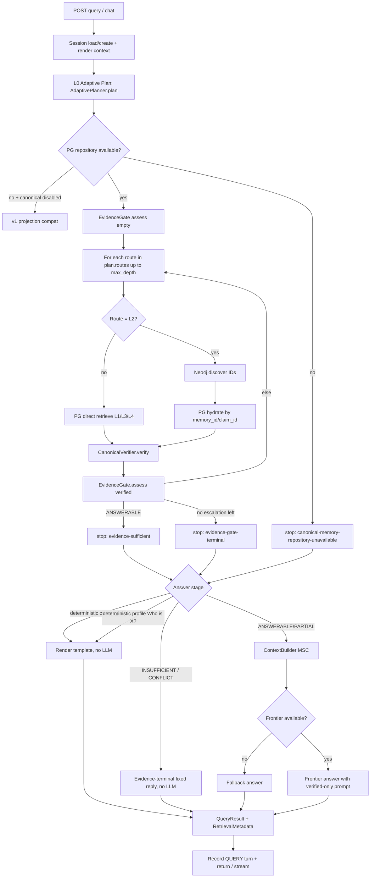

# Retrieval Flow — Ordered Cascade

The current public flow is `L0 parametric → L1 current session → L2 past
sessions → L3_FACTS → L3_VECTOR → L3_GRAPH`, with a sufficiency check before
advancing. Query and chat enter through `run_query` and share `cascade.py`.

- L0 handles self-contained general knowledge and never guesses private facts.
- L1 reads cache, then durable PostgreSQL session snapshots/original records.
  A second bounded search can recover old turns outside the cached tail.
- L2 searches PostgreSQL conversations, excludes the current session, and uses
  session summaries only to find original records. Old assertions do not
  establish that a fact is still current.
- L3_FACTS reuses canonical claim/history adapters. L3_VECTOR and L3_GRAPH
  discover stable IDs, then hydrate and verify them against PostgreSQL.
- Graph traversal uses the parameterized `t_canonical_paths` template, checks
  every node and edge tenant, limits hops/rows/time, and rejects incomplete paths.
- Current-session and historical conversation answers remain separate from
  canonical claims. Generated answers are recorded as QUERY events without
  ingestion dispatches. Session state and the event are committed atomically.

The model may refine semantic search arguments after L1 and return NEED_MORE;
the server controls stage order. No model-generated SQL/Cypher or graph schema
mutation is enabled. See [the implementation plan](ORDERED_RETRIEVAL_PLAN.md)
for migration, API compatibility, tests and the vector-representation experiment.

## Earlier capability-routing implementation (historical reference)

The description below records the previous design. Its internal L1–L4 adapter
names still exist, but no longer determine the public retrieval order.

> PG-canonical adaptive retrieval. PostgreSQL (`MemoryRepository`) is the only source allowed into model context. Neo4j / vector results are discovery candidates and must be hydrated by PG before verification. This supersedes the old filesystem-cascade diagram in `FLOWS.md` section 2.

Sources: `engram/api/routes/chat.py`, `engram/api/app.py` (`POST /api/v1/query`), `engram/retrieval/orchestrator.py`, `planner.py`, `domain.py`, `evidence.py`, `context.py`, `engram/storage/memory_repository.py`, `engram/deps.py`, `clients/python/engram_client/`.

## 1. Entry points

```
Client (engram_client.query / chat_completions / Admin chat)
  | POST /api/v1/query {query, session_id?, session_context?, max_depth?, stream?}
  | POST /api/v1/chat/completions {messages[..., user], session_id?, session_context?, max_depth?, stream?}
  v
SessionManager.get() or .create()  [engram/session/manager.py]
  | session.render(max_turns=20) -> session_context (NOT canonical memory)
  v
make_orchestrator_context(state) -> OrchestratorContext(cfg, neo4j, core, frontier, embed, memory_repository)
  v
run_query(ctx, session_id, query, session_context, max_depth, on_step)  [orchestrator.py]
```

Non-streaming returns `QueryResponse{answer, session_id, retrieval_metadata, answerability, sources, conflicts, verification_rejections}`. Streaming (`stream=true`) runs the same `run_query` in a worker thread and emits SSE: `retrieval_step` (per stage) -> `metadata` -> `delta` (12-char chunks) -> `done`. Chat then calls `_append_turn_and_record()` which saves the turn as a durable `QUERY` event with `derived_response=true` but deliberately does NOT send it to the ingestion outbox (generated answers must never become new facts).

## 2. Full flow chart



ASCII fallback:

```
chat/query -> session -> L0 plan -> [L1? -> L2? -> L4?] loop
  each step: retrieve (+hydrate if L2) -> verify -> gate
  ANSWERABLE -> stop | terminal -> stop | exhausted -> stop
  -> deterministic? -> evidence-terminal? -> MSC + frontier -> result
```

## 3. Step details

### Step 0 — Session
`SessionManager` in Redis (`session:{tenant}:{id}`). `render(max_turns=20)` supplies style/coreference context only. Never treated as evidence.

### Step 1 — L0 Adaptive Plan (`planner.py`)
Heuristic first, model only if needed:
- temporal: `as of YYYY-MM-DD`, `before/prior to DATE`, `last N days/weeks/months`, `this week/month`, `recent/lately` else `current`.
- predicate hints: manager/reports->HAS_MANAGER, work/company->WORKS_AT, role/title->HAS_ROLE, birthday/born, prefer/favorite->PREFERS, team->MEMBER_OF, school/studied, live/located/city, etc.
- entity hints: `"quoted"`, TitleCase spans, `Who is X?` identity regex, version strings, `user/i/my` subject.
- intent+route: evidence->L4, history (`previously/used to/past`)->L4, `Who is X?`+entity->L1 overview, overview/summary/profile->L3, relationship/connected/path/collaborated->L2 (predicate cleared), recent->L1, current/entity+predicate->L1, else semantic->L2.
- chains: L1=[L1,L2,L4], L2=[L2,L4], L3=[L3,L1,L4], L4=[L4].
- Core-model enrichment runs ONLY for generic semantic intent; lexical temporal/evidence/history signals always win on merge. Failure falls back to heuristic plan.

Output is validated `RetrievalPlan{query, intent, primary_route, routes, entity_hints, predicate_hint, temporal_scope{kind,as_of,since,until,days}, requires_evidence, requires_conflict_check, max_candidates, allow_escalation, reason}`.

### Step 2 — Route loop (`_run_query` in orchestrator.py)
For each `route in plan.routes` capped by `_depth_rank(max_depth)` (default `L4` from config):
update `routes_attempted`, `levels_visited`, `cascade_depth_reached`, per-route `latency_ms`, `on_step` callback for SSE. Special cases: `AmbiguousEntityReferenceError` (exact alias maps to N identities) -> stop `ambiguous-entity-reference`; any PG exception -> stop `canonical-memory-repository-unavailable`.

| Route | Meaning | Implementation |
|---|---|---|
| L1 | Current/recent canonical claims | `MemoryRepository.search_current_claims / search_recent / retrieve_l1` |
| L2 | Semantic/relationship discovery | Neo4j `vector_search/path/neighbors` -> `DiscoveryCandidate` -> PG `hydrate/hydrate_candidates/get_by_ids` -> verify with `discovery=true` (drops stale `projected_revision < canonical_revision`) |
| L3 | Overview/summary | PG overview fetch, drops non-fresh overviews |
| L4 | History/provenance | PG `get_history` with full temporal scope (retired/superseded allowed, deleted/invalid never) |

### Step 3 — Verify (`CanonicalVerifier` in evidence.py)
Keeps a row only if: `canonical=true`, `tenant_id` matches, has `memory_id/claim_id` when `require_stable_id`, status allowed (`ACTIVE/CURRENT` for current; retired allowed for history), temporal interval covers `point`/`since-until` (asserted_at must precede as-of point), not duplicate. Sorts by `retrieval_score`, `claim_confidence`. Tags `verification_source=postgresql`, preserves `conflict` flag.

### Step 4 — Gate (`EvidenceGate.assess`)
- filters by predicate match if `predicate_hint` set; for pure semantic/general requires lexical bridge (`_query_covered`) between query tokens and hydrated text.
- conflicts: explicit `conflict/CONFLICTING` rows + inferred same subject+predicate with distinct values and overlapping validity intervals (skipped for HISTORY scope unless explicit).
- states: `CONFLICTING_EVIDENCE` if conflicts; `INSUFFICIENT_EVIDENCE` if zero rows (`missing=[predicate:X|entity:Y]`); `PARTIALLY_ANSWERABLE` if low-confidence or missing provenance when required; else `ANSWERABLE`. Sets `can_escalate/next_route` from remaining `plan.routes`.

### Step 5 — Answer (`_finish_query`)
Order matters:
1. Deterministic current_fact: single subject, 1-5 rows, known template (WORKS_AT, HAS_MANAGER, HAS_ROLE, MEMBER_OF, LOCATED_IN, etc.) -> `"{Subj} works at {Obj}."` No LLM.
2. Deterministic profile: intent=overview, route=L1, 1 entity hint -> up to 3 clauses (`serves as`, `works at`, `reports to`, `is manager of`), cleans `project_orion`->`Project Orion`, `fictional` mentioned once. No LLM.
3. Evidence-terminal: insufficient/ambiguous/conflicting -> fixed product strings (`I don't have enough verified memory evidence...`, `I found multiple canonical entities...`, `I found conflicting verified memory...`). `total_context_tokens=0`, no MSC built.
4. MSC + Frontier: `ContextBuilder.build()` with budgets (`full_doc_budget` if L4 attempted else `overview_budget`; session 15%, evidence 70%) renders `## Retrieval assessment + ## Verified canonical memory + ## Session context (not canonical) + ## User query`. Frontier called with verified-only system prompt, 2-4 sentences, preserve direction/uncertainty. Failure -> graceful `answer generator temporarily unavailable`. Records token usage per stage (`l0_plan`, `frontier_answer_0`).

### Step 6 — Return
`QueryResult{answer, retrieval_metadata, answerability_state, verified_evidence}`. `retrieval_metadata` includes `cascade_depth_reached, levels_visited, predicted_depth, nodes_retrieved, total_context_tokens, latency_ms, l0_decision=ROUTE, l0_reason, answerability_state, routes_attempted, candidates_discovered, verified_evidence, missing_evidence, conflicts, canonical_revision, temporal_scope, stop_reason, answer_mode, token_usage`.

## 4. Failure / edge table

| Condition | `stop_reason` | Answer |
|---|---|---|
| PG down | `canonical-memory-repository-unavailable` | Canonical retrieval unavailable |
| Alias ambiguous | `ambiguous-entity-reference` | Ask for disambiguation |
| No rows survive | `evidence-gate-terminal` or `adaptive-routes-exhausted` | Not enough verified evidence |
| Conflicts | preserved from gate | Cannot select one current answer |
| Frontier down/missing | `frontier-provider-unavailable` | Verified retrieval done, fallback text |

## 5. Where to read / change

- Add intent/route: `planner.py:_heuristic_plan`, `domain.py:RetrievalIntent/Route`.
- Add repository method: `orchestrator.py:_repository_retrieve` name tuples + `storage/memory_repository.py`.
- Loosen/strict verify: `evidence.py:CanonicalVerifier`, `_temporal_match`, `_status_allowed`.
- Change sufficiency: `evidence.py:EvidenceGate`.
- Change prompt/budget: `orchestrator.py:_finish_query`, `context.py:ContextBuilder`.
- Cap depth: request `max_depth` (`^L[0-4]$|^SESSION$`) or `config.yaml:retrieval.max_depth`.
