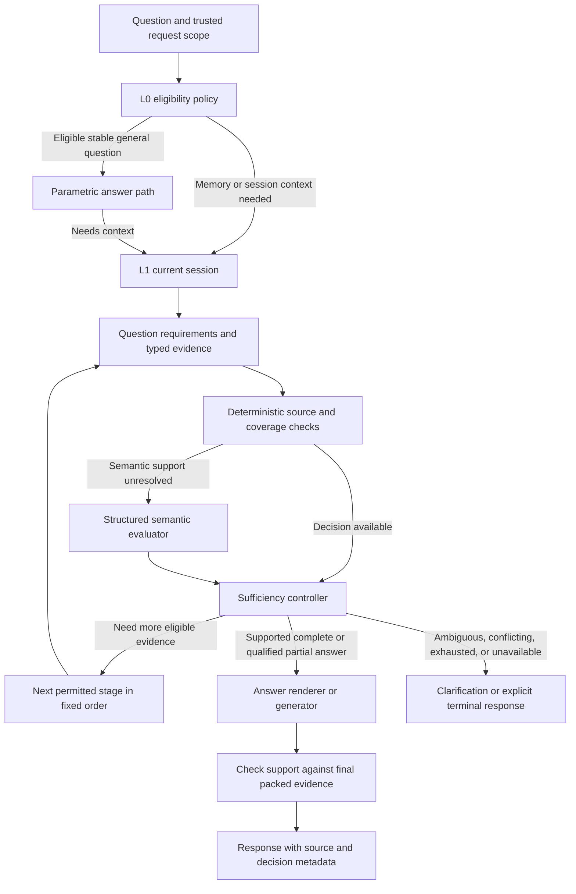

# Engram retrieval sufficiency architecture

Reviewed: 2026-09-29. Status: **proposed implementation plan; runtime behavior has not been changed by this review**.

This refines R1/R2 and RC-A/B in [ORDERED_RETRIEVAL_PLAN.md](ORDERED_RETRIEVAL_PLAN.md). The release remains tenant/API-key scoped. It preserves PostgreSQL authority, the existing ordered retrieval cascade, BM25/vector fusion, controlled graph templates, and asynchronous Temporal memory processing.

## Decision

Introduce one application-owned `SufficiencyController`, used by every retrieval stage. It combines deterministic eligibility and coverage checks with a separate, structured semantic evaluator when needed. The controller decides whether to answer, continue, clarify, return a supported partial answer, report conflict, or abstain. The answer generator consumes that decision.

The semantic evaluator is a distinct responsibility with its own input/output schema, prompt, tests, and metrics. Initially it can use the existing `CoreModelProvider`; it does not require a separate deployed model, microservice, database, or trained classifier. Sharing a model provider does not make the evaluations statistically independent. Select a different model or distill a smaller classifier only after evaluation demonstrates a benefit.

The key question is: **Does the eligible evidence cover each requirement in this particular question?** Retrieval relevance, extraction confidence, and grammatical plausibility do not establish that coverage.

## What the repository does today

| Finding | Evidence and consequence |
|---|---|
| Ordered retrieval is already centralized | `orchestrator.run_query()` delegates to `cascade.run_cascade()`. Preserve this control flow rather than adding an autonomous tool-selection loop. |
| Conversation sufficiency and answer generation share one call | `cascade._try_conversation_answer()` accepts a nonempty Frontier `ANSWER` without a structured mapping from answer requirements to source messages. Speaker/source restrictions are in the prompt. |
| Canonical eligibility has useful guards | `evidence.CanonicalVerifier` filters tenant, identity, status, temporal eligibility, and stale discovered projections before evidence assessment. Retain these guards outside model control. These checks establish stored-record eligibility, not objective truth. |
| Predicate coverage is narrower than question coverage | `EvidenceGate.assess()` checks whether each required predicate occurs somewhere. It does not require that predicate for each requested entity, or independently establish an explanation, comparison, count, or complete set. |
| Semantic coverage is a relevance heuristic | `_query_covered()` accepts a context anchor or any selected query token in the evidence text/fields. Matching the project and database name does not establish why a migration happened. |
| Conversation evidence is often flattened | `chat._request_context()` renders turns to text; `MemoryTools.current_session_search()` accepts supplied context first and often records a session-level source reference. Stable per-message provenance must survive this path before a semantic evaluator can cite it reliably. |
| Classifier naming can be misleading | `l0_gate.py` contains a placeholder binary classifier and an embedding/graph fallback. The active cascade does not call `run_l0_gate()`. That query-only classifier asks whether context may be needed, not whether retrieved context answers the question. Wiring its graph fallback into L0 would also violate the agreed retrieval order. |
| Depth control is server-owned, but sufficiency policy is split | The cascade controls actual forward movement. `EvidenceAssessment.next_route/can_escalate` refer to legacy capability routes, while the active cascade uses public stages. Unify policy ownership and retain legacy values only for compatibility. |

The model planner's `_PLAN_SCHEMA` also lacks the runtime `required_predicates` field. A typed requirement contract should replace this mismatch, not rely on additional prompt prose.

### Review validation

The following existing, isolated unit suites passed during this review: `test_ordered_retrieval.py`, `test_adaptive_retrieval.py`, `test_retrieval_coverage.py`, and `test_hybrid_retrieval.py`: **50 passed**.

Additional in-memory probes against the existing code showed:

1. A plan asking for Alice's and Bob's current roles, with both entity hints and `HAS_ROLE` required, received only Alice's role. `EvidenceGate` returned `ANSWERABLE` with no missing requirements.
2. A semantic plan asking why Atlas migrated to PostgreSQL received only `text="Atlas uses PostgreSQL."`. `EvidenceGate` returned `ANSWERABLE`.
3. An assistant-only session statement, with a stub Frontier returning `ANSWER`, stopped at L1 with no canonical evidence. This demonstrates the absence of a programmatic source-support check; it is not a measurement of how often a live model makes that mistake.

These are component/boundary reproductions, not claims that every end-to-end query produces a wrong answer. The Frontier can still reject weak knowledge-base evidence. Existing passing tests primarily prove ordering and selected guardrails; they do not certify semantic sufficiency. No production database or live model was used in these probes.

## Proposed control flow



The retrieval order remains **L0 → L1 → L2 → PostgreSQL facts → BM25/vector → graph**. L1 includes cache/snapshot reads and, when needed, original-record search. Consider stages in that order; record why an inapplicable stage is skipped. A model supplies evidence assessments and bounded search hints; the server supplies scope, budgets, and the next permitted stage.

The sufficiency checkpoint first runs after loading L1 and is reused after each material evidence change. It is not a one-time decision before all later databases. L0 remains a special policy path: an allowed general answer has `basis=parametric`, not a claim of verified memory support. When session constraints are unknown, load L1 before answering.

## Contracts to implement

### Question requirements

Extend `RetrievalPlan` with bounded `AnswerRequirement` records. Each record contains:

- A server-assigned requirement ID and the original question span it represents.
- Entity bindings or unresolved entity references; predicate when applicable; relationship direction and requested endpoints where relevant.
- Operation: lookup, explanation, comparison, relationship path, historical statement, summary, count, or enumeration.
- Time scope, source/provenance requirements, and whether exhaustive coverage is needed.
- Required/optional status and ambiguity information. An unresolved requested clause must remain visible.

For “What are Alice's and Bob's roles?”, create separate requirements for Alice's role and Bob's role. For “Why did Atlas migrate?”, require a supported reason. Do not infer a reason from evidence that merely names the destination database.

Use deterministic parsing for supported exact lookups. For complex language, use bounded structured model decomposition after L1 is available; validate against the original question and retain unhandled clauses as unresolved. Do not silently discard question parts when the requirement budget is exceeded. A proposed starting cap is 16 requirements, subject to evaluation. Entity ambiguity yields clarification instead of a guessed identity. First-person references retain the existing session/tenant interpretation; they must not imply private-user authentication that this release does not have.

### Typed evidence

Introduce an `EvidenceItem` envelope shared by session and canonical adapters. Fields include server-controlled source reference, kind, tenant scope, session/turn/event or canonical claim/version identity, speaker, timestamp, applicable temporal bounds, revision, eligible operations, source text, and truncation/availability metadata.

| Source | Permitted support |
|---|---|
| Accepted current user message | Explicit assertion, instruction, or what the user said, with source attribution. Latest input is available immediately even while memory ingestion is pending. |
| Past user message | What was stated at that time. Current-state questions need an explicit freshness/validity policy; a search match alone is insufficient. |
| Assistant message | What the assistant said, or context for a user request. It cannot independently establish a user/world fact. |
| Caller-supplied context | Current request context with its origin identified. Caller-provided role labels cannot manufacture trusted historical events or canonical provenance. |
| Canonical claim/version | Evidence within its tenant, source, status, and time constraints after PostgreSQL verification. |
| Compacted or consolidated summary | A discovery/presentation aid. Resolve source dependencies before using its factual content to satisfy a requirement. |

`Turn.turn_idx`, tenant/session scope, and existing event identities can support the first release without replacing message storage. If an old snapshot has no recoverable event reference, preserve that limitation; never invent provenance. Structure and budget whole message units rather than truncating a string across speaker boundaries.

### Semantic evaluator and controller output

The evaluator receives the original question, validated requirements, and already eligible evidence. It returns **per-requirement** `SUPPORTED`, `MISSING`, `CONTRADICTED`, or `UNKNOWN`, with referenced evidence IDs, exact source spans where applicable, and short reason codes. It returns no final user answer, SQL/Cypher, tenant scope, or stage-selection command.

The controller validates every ID and span against the supplied items, applies subject/predicate/direction/time bindings, and computes the aggregate decision. A model-reported confidence number cannot override missing sources or a failed rule. Valid citations establish traceability; semantic entailment remains an evaluated model capability.

Illustrative controller result:

```json
{
  "state": "PARTIALLY_ANSWERABLE",
  "action": "CONTINUE",
  "requirements": [
    {"id": "alice-role", "status": "SUPPORTED", "evidence_ids": ["claim-alice-role"]},
    {"id": "bob-role", "status": "MISSING", "evidence_ids": []}
  ],
  "reason_codes": ["MISSING_ENTITY_PREDICATE"],
  "decision_basis": "deterministic"
}
```

This is a proposed contract. Keep the four existing public `AnswerabilityState` values for compatibility, and add controller action, per-requirement coverage, decision basis, and operational status as metadata. `CLARIFY` and `UNAVAILABLE` must be distinguishable from “there is no evidence,” even if their compatibility answerability state is `INSUFFICIENT_EVIDENCE`.

## Decision policy

| Condition | Controller behavior |
|---|---|
| Every required part has eligible support, with no relevant unresolved conflict | Answer; use existing deterministic exact-fact rendering when applicable. |
| Some parts are missing and a later permitted stage may help | Continue in order, retaining accumulated eligible support and the missing requirements. |
| Entity/time/reference is ambiguous and more retrieval cannot resolve it safely | Ask a focused clarification. |
| Authoritative evidence has an unresolved conflict | Report the conflict. Historical changes with disjoint validity periods are not automatically conflicts. |
| Only part is supported and useful independent facts can be stated at exhaustion | Return a qualified partial answer naming the missing parts. Never present an incomplete comparison/count as complete. |
| No support remains or an unsupported external/current fact is requested | Abstain or state the missing capability. Do not let parametric knowledge fill a private factual gap. |
| Retrieval/model timeout, invalid output, or budget exhaustion | Mark the operational cause; continue only within remaining authority/depth/deadline. Exact deterministic answers remain available. Otherwise qualify or abstain. |

Absence of a retrieved claim does not prove a negative. Counts, “all” lists, and universal statements require an explicit completeness signal from an eligible source/query. Similarity, BM25 score, RRF rank, and extraction confidence remain ranking/quality signals, not sufficient-answer thresholds. The current `EvidenceGate` confidence default is zero; the new design must not describe it as a calibrated confidence classifier.

Current-session assertions and canonical claims can disagree while asynchronous ingestion catches up. Preserve both sources and timestamps. An explicit newer user correction can support an attributed response about what the user just said; it must not silently rewrite canonical state or be presented as a completed memory update.

## Generation, packing, and consolidation boundaries

Pack evidence before the final authorization to answer. Recompute coverage on the exact packed items, preserving whole graph paths and their directions. The support report is keyed to the requirement version and evidence revision/fingerprint, so packing or a changed source invalidates stale approval.

Move normal answer generation after sufficiency approval. Keep deterministic rendering for supported exact facts. For semantic answers, require a support map for factual statements and validate references; invoke a bounded semantic support check only where deterministic checks cannot establish support. The same model family checking itself remains fallible and must be tested accordingly.

The generator may veto with `NEED_MORE`, but cannot upgrade missing/invalid evidence. Permit at most one controlled additional generation attempt after material new evidence or a narrower approved answer scope. The controller still enforces forward-only retrieval and the request budget. Remove the provider instruction forcing a best-effort `ANSWER` on incomplete context from the new policy path; final partial/abstention behavior must follow the controller's decision.

Consolidation continues to run through Temporal, outside interactive retrieval. Its overview dependencies can locate source evidence for the controller. Waiting for a new summary is not a prerequisite for answering from a committed claim or a just-accepted user statement. This work does not introduce new graph labels, generated Cypher, or autonomous schema changes.

## Cost and operational bounds

- Use deterministic decisions for empty evidence, invalid sources, exact fully bound facts, and known missing required fields. Do not call a model to rediscover a missing ID or tenant mismatch.
- Decompose a complex question once; reuse the requirements. Reassess semantically only when eligible evidence or requirements change. Request-local memoization includes policy/prompt version, source kind, temporal scope, revisions, and packed content fingerprint; avoid cross-tenant/global verdict caches.
- Budget decomposition, semantic review, generation, and any repair together. A proposed ceiling is six semantic assessments across L1 tail, L1 originals, L2, facts, hybrid, and graph, with no repeated call for an unchanged evidence set. Exact paths use fewer or zero assessments. Set input/output caps and a request-wide wall-clock deadline; choose production numeric time/token limits from representative model latency and load results.
- Extend provider calls with remaining-deadline support; a timeout around a synchronous thread alone does not bound the provider operation. Bound concurrent evaluator work and degrade explicitly on overload.
- Record stage, requirement counts, decision, reason codes, eligible/rejected source counts, degraded dependencies, model/prompt/policy versions, token use, and timings. Store source references/fingerprints rather than copying raw conversation text into operational logs. Keep existing response source fields and SDKs compatible.
- Measure total cost and latency against the current implementation. A separate judge may add latency to easy cases; do not promise savings until evaluated.

## Implementation sequence

| Phase | Changes | Exit condition |
|---|---|---|
| S0 — Reproduction and contract | Turn the review probes into behavioral regressions; define requirements, evidence envelopes, and controller decisions in `retrieval/domain.py`. Add review cases to the evaluation corpus. | A concrete expected decision exists for each reproduction and source kind. New requirements cannot vanish on parsing failure. |
| S1 — Deterministic coverage and source plumbing | Add `retrieval/sufficiency.py`; refactor `EvidenceGate` to match entity/predicate/operation/time requirements. Carry structured accepted turns through `api/routes/chat.py`, `session/manager.py`, and `retrieval/tools.py`; preserve string inputs through a clearly labelled compatibility adapter. | Alice-only evidence cannot fully answer the Alice-and-Bob question. Assistant-only statements cannot establish user facts. Typed exact lookups retain early exit. |
| S2 — Semantic evaluation | Add `retrieval/sufficiency_judge.py` and `prompts/retrieval_sufficiency.j2`; use the existing core provider with strict output validation. Align `planner.py` JSON schema with runtime contracts. Add deadline propagation/configuration. | Explanation, comparison, negation, paraphrase, malformed output, unknown IDs, and adversarial source cases have evaluated decisions. No judge can broaden scope or select arbitrary queries. |
| S3 — One controller across the cascade | Refactor `cascade.py`, `orchestrator.py`, and `context.py` so each stage uses the controller. Recheck packed support, then generate; handle generator veto and bounded repair. Update provider terminal instructions and additive API metadata/SDKs. | Fixed ordering, depth caps, source attribution, supported partial answers, and operational error distinctions hold across L0–graph and buffered/streaming chat. |
| S4 — Evaluation and rollout | Run rules-only and rules-plus-judge variants against the current baseline; shadow the new controller, then canary approved query groups. | Release gates below pass; rollback retains source/tenant/status guards and flags uncertainty explicitly. |

Before graph coverage can be trusted, add an adjacent regression for a direct A→B path: the current template returns the edge's start memory but no end memory, while `graph_search()` checks requested endpoints from discovery fields. A stubbed adapter probe returned zero evidence with the actual template's field shape and one verified edge when subject/object endpoint fields were supplied. Hydrated subject/object identities must establish connected endpoints and direction. This retrieval adapter issue cannot be fixed by a stronger sufficiency prompt.

Rollout configuration should distinguish `legacy`, `shadow`, and `enforce`. In shadow mode the new verdict has no effect on the response, and its requests have independent bounded resource limits. During canary, disabling the semantic evaluator must not disable the new deterministic source/coverage guards; unresolved semantic questions continue conservatively. Retain existing stage labels (`L3_VECTOR` includes BM25) and `max_depth` semantics. No new database is needed; add persistent decision storage only if an explicit audit requirement later justifies it.

## Acceptance and evaluation

Required cases include:

1. Single exact fact; no deeper calls after complete support.
2. Two entities with the same predicate, only one answered; two predicates with only one answered.
3. Explanation with only an event statement; causal claims require supporting reasons.
4. Comparison requiring both sides; counts/enumerations with incomplete source coverage.
5. Negation and absent evidence; supported historical statements versus unsupported current-state assertions.
6. Assistant-only claims, mixed user/assistant turns, forged caller-supplied role text, and instructions embedded in source content.
7. A latest user correction awaiting ingestion, conflicting canonical claims, and explicit historical change.
8. Cache miss/expiry, oversized or truncated records, summaries with expired/missing dependencies, and source deletion.
9. Tenant mismatch, ambiguous identity, stale projection, missing graph edge, wrong direction, and a valid two-endpoint path.
10. Evidence removed during packing; approval cannot outlive its evidence fingerprint.
11. Model timeout, malformed JSON, hallucinated evidence IDs, context/token budget exhaustion, and unavailable PostgreSQL/Neo4j.
12. L0 public knowledge with active session constraints, all depth limits, fixed stage order, and bounded answer-model veto handling.

Build a reviewed corpus with per-requirement support labels, earliest sufficient stage, admissible source types, and expected terminal behavior. Include anonymized representative queries where permitted and deliberately constructed hard negatives. Split by session/entity/template family to limit leakage. Human review should adjudicate semantic correctness and disagreements; the same production judge must not supply all evaluation truth.

Compare three variants: current hybrid gate, deterministic coverage alone, and deterministic coverage plus semantic evaluation. Report false-sufficient decisions, supported-answer precision, supported coverage/abstention, unnecessary escalation, clarify/conflict accuracy, p50/p95 latency, tokens, and cost per query. Break results down by source kind, query operation, stage, and tenant/source coverage.

Proposed release gates, to be measured rather than asserted:

- All deterministic boundary and ordering regressions pass; zero tenant/source-trust violations in the adversarial acceptance set.
- False-sufficient rate improves over baseline without unacceptable loss of supported-answer coverage. An initial target is a one-sided 95% upper confidence bound of at most 1% on an independently reviewed insufficient-context set. With zero observed errors this needs at least 299 reasonably independent cases; clustered/template-derived cases need a larger or cluster-aware evaluation. Report difficult slices separately.
- Precision and coverage are evaluated together so always abstaining cannot pass. Select the operating point on validation data, then report it on a held-out set with uncertainty.
- Production p95 latency/cost and provider concurrency budgets are established from the baseline and canary measurements before broad enablement. No latency or accuracy improvement is established by the 50 unit tests.

## Why this fits Engram

Engram already has the cascade, canonical verifier, typed planner, model provider interfaces, source events, and temporal memory lifecycle. The next useful boundary is a shared evidence-to-requirement decision with an explicit semantic evaluator. A new query-only binary classifier would not resolve the reproduced entity and explanation gaps; training one also requires labels the repository does not yet establish.

Primary research supports evaluating context sufficiency separately from whether a generator chooses to answer: [Sufficient Context: A New Lens on Retrieval Augmented Generation Systems](https://arxiv.org/abs/2411.06037) studies those failure modes and selective generation. [Self-RAG](https://arxiv.org/abs/2310.11511) explores learned retrieval and critique. These motivate the evaluation direction; neither establishes that a particular model or threshold is accurate for Engram. The architecture above is a repository-specific engineering recommendation, with that choice left to measured validation.
